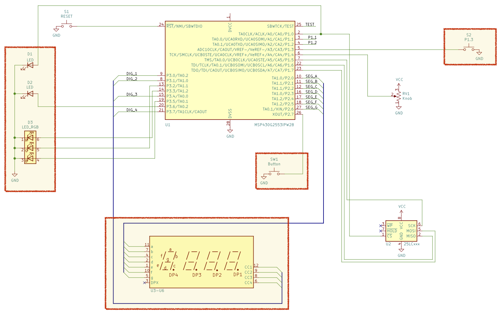
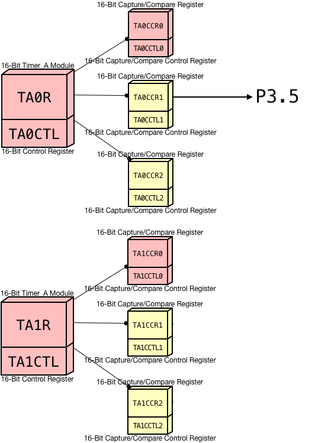

# A3: Signals

### Schematic

### Running Modes

##### Mode 0

1. Red LED blinks every 1/4 a second (using execution loop)

##### Mode 1

1. Red LED blinks slower, every 1/3 second (using execution loop)
2. Green LED blinks every 1/2 second (using timer & interrupt)

##### Mode 2

1. Red LED turns off
2. Green LED blinks every 1/2 second (using timer & interrupt)
3. Blue LED blinks every 1/3 second (using timer & signal)

##### Mode 3

1. Red LED stays off
2. Green LED turns off
3. Blue LED blinks slower, every 1/2 second (using timer & signal)

### Objective

For this assignment, you should attempt to recreate the RGB LED activity listed above _with the method inside parenthesis_. Pressing the button on the Blacktop should advance to the next mode (advancing from 3 should go back to 0) and pressing the side button on the Launchpad should step back to the previous mode (moving backward from 0 should set the mode to 3).

Because you are using the buttons as interrupts, the completed program will have some initialization, execution loop and three interrupts: one for **TIMER1_A0_VECTOR**, one for **PORT1_VECTOR** and one for **PORT2_VECTOR**.

### Tips

Do not set hardware parameters in the execution loop based on what mode you are in (for instance, checking to see what mode you are in every loop iteration and enabling interrupts for the timer if in Mode 1 or 2, otherwise disabling interrupts if in Mode 0 or 3).

**This is a waste of time**. You should set hardware parameters _only when changing modes_.

### Timers Map

Here is a map of the two timer modules and their relevant "registers":

